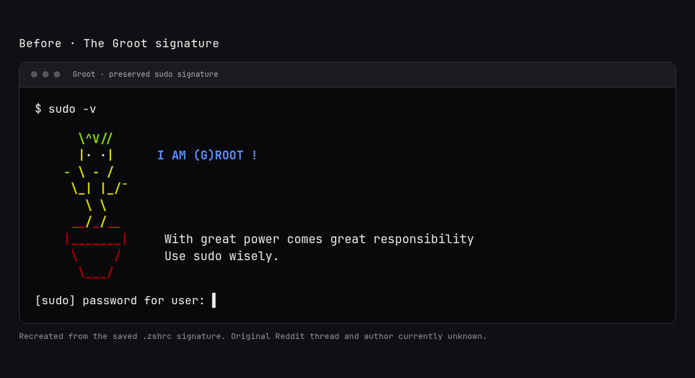
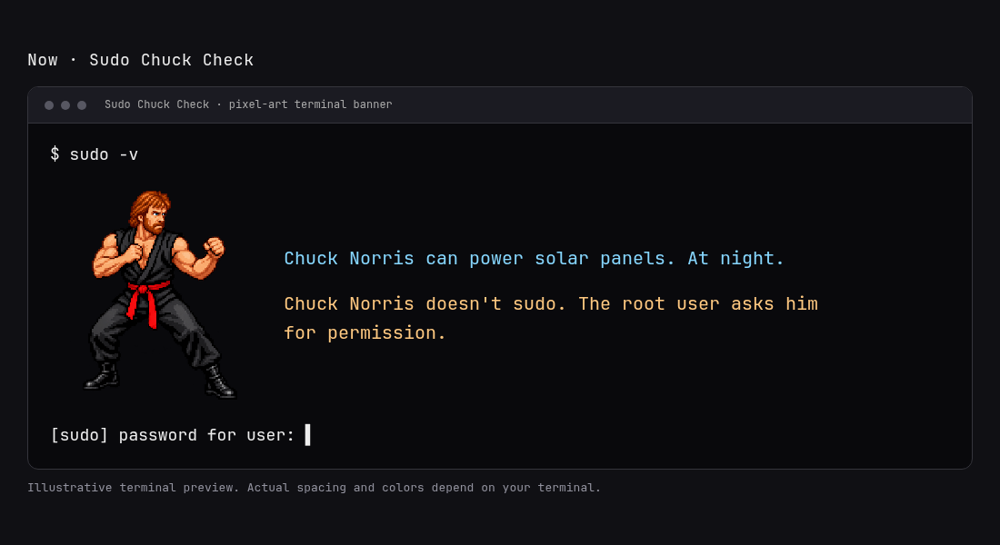

# From Groot to Sudo Chuck Check

I'm a computer enthusiast, not a programmer. Years ago I saw a Groot sudo signature
in a Reddit thread and enjoyed it enough to use it in my own terminal. Whenever
sudo needed a password check, the little ASCII Groot appeared with “I AM (G)ROOT !”
and a reminder:

> With great power comes great responsibility
> Use sudo wisely.

*Recreated from the signature saved in my `.zshrc`; this is not a screenshot from
the original Reddit thread. I no longer have the thread URL or the author's name.*

Later, seeing [Paul Hocker's Chuck Norris plugin for Omarchy](https://plugins.omarchy.org/plugin.html?id=paulhocker.omarchy-plugin-chuck)
gave me the idea to rework that old signature. I wanted a different joke each time,
a picture of Chuck beside it, and a closing line that made me smile. I used AI tools
to help turn that idea into working code because programming isn't my background.

The first version used ASCII Chuck artwork. I wasn't happy with how it looked, so
we replaced it with a transparent, retro pixel-art Chuck Norris in a fighting stance.
The final line became:

> Chuck Norris doesn't sudo. The root user asks him for permission.

*An illustrative terminal preview rendered from this project's HTML preview;
actual spacing and colors depend on the terminal.*

The result is **Sudo Chuck Check**: a small standalone Zsh customization I can share
with other enthusiasts. Hocker's plugin provided the spark; neither it nor Oh My
Zsh needs to be installed. The package includes the sprite and a collection of
offline jokes from Oh My Zsh, with its credits and license retained.

## Preserving where it started

The [original Groot signature](history/groot-original.zsh.txt) is preserved as text
for the project's history. It is not installed as an active sudo function. Its
Reddit author and original license have not been identified; no authorship claim
is made for that historical snippet. If you recognize the source, please share
the thread so the original creator can be credited.

The project was initially packaged as **Chuck Sudo**. It was renamed **Sudo Chuck
Check** when this history and the before-and-after previews were added. Earlier
commits are retained so that development history remains visible.

The concept, preferences, and decisions came from me; AI tools helped with the
implementation, testing, documentation, and new sprite. This project is a record
of an enthusiast making something enjoyable with the tools available.
